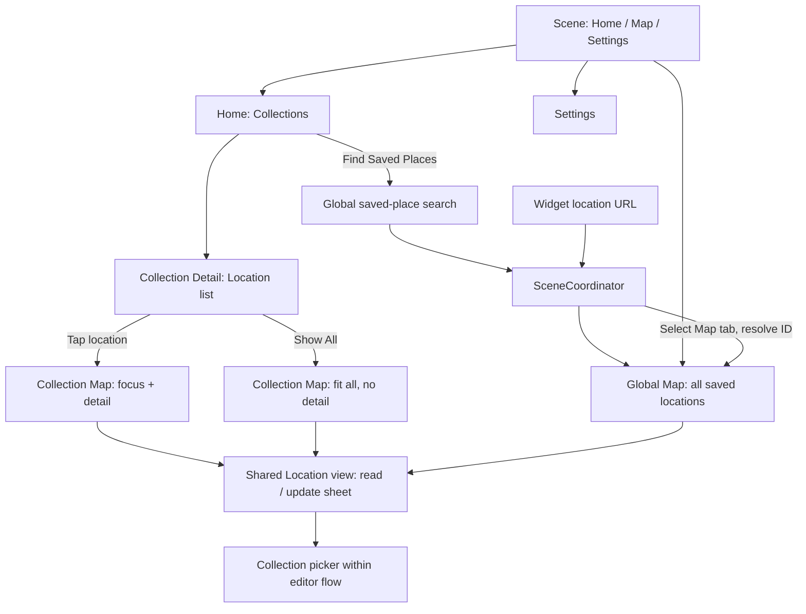
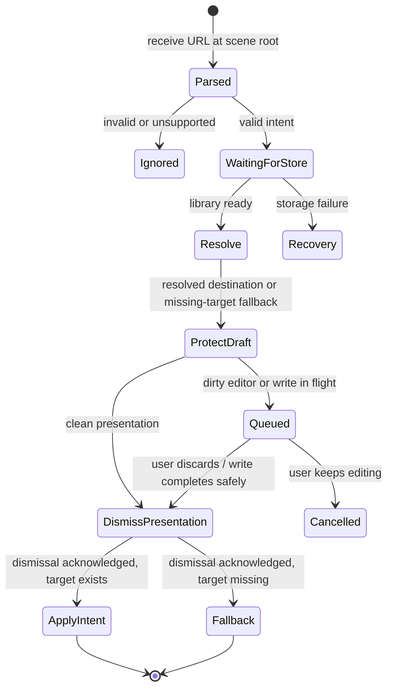

# Navigation, deep links and restoration

## Navigation model



Home, Map and Settings remain exactly three top-level destinations. On compact available width, use one navigation stack per destination. At wider sizes, let the system adapt the tab presentation to a sidebar and use `NavigationSplitView` or another standard split/adjacent presentation where the content hierarchy benefits. Keep separate Home/Map/Settings route types and one logical route graph: a column becoming visible or collapsing must not invent a competing navigation path or reset the selected destination.

Conceptual route values (not copy-ready implementation):

```swift
enum HomeRoute: Hashable, Codable {
    case collection(id: UUID)
    case collectionMap(collectionID: UUID, entry: CollectionMapEntry)
}

enum CollectionMapEntry: Hashable, Codable {
    case all
    case location(id: UUID)
}

enum SettingsRoute: Hashable, Codable {
    case language
}
```

Tab roots do not have to be elements of a path. The existing `root` property may remain if useful. Global Map selection is its session state, not a pushed HomeRoute. Do not force an unused wrapper Route enum across all tabs merely because the scaffold has one.

Route values carry IDs and entry intent; they never carry a saved entity snapshot, closure, View, ViewModel, ModelContext or MapKit object. The selected location can change after entry without rewriting the path. SwiftUI supports programmatic paths for deep links and restoration. [Apple navigation guidance](https://developer.apple.com/documentation/swiftui/understanding-the-navigation-stack)

When Home opens a collection, it may supply the tapped name as a scene-local title hint outside the route value. This lets Collection Detail render its navigation title on its first displayed frame while loading the current record by ID. The loaded name replaces a stale hint; deleted or unrestorable IDs use the missing-entity path. Deep links/restoration carry only IDs and must resolve current data before presenting an authoritative title.

## SceneCoordinator responsibilities

Selected-place straight-line distance, route estimate, automatically derived Walking/Driving mode and request generation belong to their existing map session, shared with its explicit read-only detail. They survive presentation-only changes without duplicate requests. Neither the card nor explicit detail owns a transport picker or manual override. Candidate selection reuses its retained authorized valid origin and requests no new fix; replacing/clearing the candidate or lifecycle cancellation invalidates obsolete route work. Provider availability governs route-versus-fallback display under document 06, with no upper-distance cutoff: route success hides direct distance, loading does not display fallback, and only no-route/service failure displays labeled direct distance, without separate unavailable text, transport icon or ETA row. The no-origin outcome remains unavailable without a route request; read-only detail omits the travel section instead of showing an unavailable-origin row. On first entry to each pushed Collection Map session from Collection Detail, silently acquire one one-shot current position only when permission is already authorized and location services are enabled. Do not request permission or show an alert/toast for undetermined, denied or restricted permission, disabled services, acquisition failure or timeout. Use a successful fix only as the distance/ETA origin; preserve selected saved-location UUID, card, camera and collection scope, without inserting or selecting My Location. Explicit Get Current Location retains its existing permission prompt, denial Settings/Cancel alert and other explicit feedback/camera behavior. Cancel obsolete acquisition/route work and reject stale completions; returning to the retained session or presentation-only changes do not repeat first-entry acquisition.

The coordinator owns selected tab, the three routers, modal ownership, pending external intent and navigation restoration. It references map-session presentation models through narrow interfaces. It does not own every form field or implement repository operations itself.

| Event | Result |
|---|---|
| Select Collection | Push its ID-based list in Home and provide the tapped name as an immediate scene-local title hint |
| Find Saved Places | Preserve Home path/filter; select Map tab and present Global Map search with `All Saved Places` scope |
| Select list Location | Push/activate that collection's separate map, focus ID and show its floating card; preserve Global Map session and list query/scroll |
| Show All | Push/activate that collection's map and issue fit-all camera intent |
| Back from Collection Map | Close map presentation and pop to list, preserving list query/scroll |
| Select another tab | Keep each tab's path and camera/session state |
| Widget Location | Select global Map, resolve latest record, focus and open detail |
| Selected Location deleted | Clear detail/selection, keep camera, show unavailable message if triggered externally |
| Scope Collection deleted | Trim Home path to nearest valid ancestor; typically Home |
| Selected Location moved | Collection Map removes selection if out of scope; Global Map keeps selection |

Retain native top-level tab/sidebar navigation while Collection Map is the visible Home destination and when returning to the list. Opening or leaving Collection Map must not trigger a layout jump from hiding or restoring that navigation. Collection Map remains a pushed Home route with Back, independent of Global Map state. Global Map also retains top-level navigation. Native modal sheets can temporarily cover underlying controls; Close remains available so users can return to top-level navigation. Do not draw a second custom tab bar or sidebar on top of a system presentation.

## Collection carousel and save-sheet ownership

Collection Map stays on Home's route with one existing map-session owner. Its selected UUID drives the pin and focused card through the entire collection, independent of list filtering. Order is createdAt descending then UUID ascending. Swipe and pin selection update that selection without changing route/scope or wrapping; no visible page index or Previous/Next controls are added. Invisible keyboard and accessibility scroll alternatives operate the same selection. When the carousel contains more than one item, use the same reduced item width for saved locations and temporary current-location, native-POI and Search cards in every available geometry, including landscape and wide or height-constrained windows, so part of a neighboring item remains visible. Count the temporary item when deciding whether paging is available, including one temporary plus one saved item. Switching or paging between temporary and saved selections must not change item width at the same geometry. A single-item carousel uses the viewport’s usable width without reserving a neighboring-item peek; the landscape viewport cap still applies. Compact portrait-like single-card width is unchanged. In wide/lower-leading geometry, including landscape, cap the entire card-list viewport, including resting margins, at one half of the available map width; compact portrait-like viewport width is unchanged. Keep scrolling content within that viewport during dragging, deceleration, rest and resizing, with 12-point resting outer insets. Keep the selected card at full opacity and reduce opacity uniformly across each entire unselected card, including its content and controls. Do not add a blurred edge layer or gradient fade; opacity follows selection even at the list ends. Geometry and padding changes preserve the same map session, selection, camera and draft. Only the selected settled card requests ETA; obsolete requests cannot replace newer selection. Show All fits the complete scope. Global Map state remains independent.

In Collection Map, selecting current location, a resolved Search place or a native POI inserts and selects one temporary card before all saved cards of the scoped collection. A new temporary selection replaces that item rather than accumulating cards; saved records retain their existing order and membership. The temporary card, including My Location, has X. X removes that item and selects/focuses the first saved location in the current collection without requesting a position fix; saved collection cards have no X. The Global Map candidate-X/current-position behavior remains unchanged. The temporary identity is presentation state, not a persisted Location or another route/selection owner; preserve it through resizing and invalidate obsolete selection/route work when it is replaced or removed.

An unsaved selection has one stable draft. Card Add only opens the collection/details sheet; explicit Save in that sheet is the sole commit action. Destination defaults under D-07 and remains editable inside the sheet with optional name, notes and photos. Candidate/current-position draft coordinates stay fixed from sheet opening through retry/commit. Saving disables repeated submissions. Persistence success changes the card to Edit or the existing out-of-scope receipt under D-08, without a destructive toggle. Geometry/display/pose changes cannot recreate the draft or discard fields/staged media. Existing dirty-draft interruption and modal arbitration remain required.

## Modal ownership

Use an explicit scene/map session for mutually exclusive Search and shared Location-view presentations (read/update modes), while retaining the selected map card state underneath. The floating quick-view card follows document 06's available-space placement and progressive content priority, remains present at extreme text sizes with fixed height for the same available map geometry, bottom-anchored actions with 12-point internal padding, and its bottom edge approximately 8 points above the top of the actual Maps/legal row under document 06; the former legal-clearance-reduction exception is superseded; explicit card activation opens the read-only View Details sheet without creating another selection owner. There is no separate Details button. Card touch activation is tap only, with reduced pressed opacity and one light haptic on successful activation; drag/swipe/cancel produces neither detail nor its activation haptic. Preserve native keyboard/accessibility equivalents. All card actions, More Actions and X activate independently without also opening detail. Horizontal carousel swipes retain paging without opening a sheet. Native POI selection and search-result selection share this map-owned candidate/card/detail state, while retaining their marker origin: provider marker only for a native POI, app marker with its title below the glyph for a search result. Saved app annotations use Name rather than Custom Name, and Search annotations use the resolved name; both retain native title rendering close to the 24-point glyph as in the Location Detail minimap, with full interaction bounds of at least 44 by 44 points and no extra blank spacing between glyph and title. Card/list/detail display-name policies remain unchanged. Keep native focus separate from the accepted candidate/card/source. Native POI focus loss or unselection clears native selection and invalidates obsolete pending resolution while retaining the accepted card/source and camera; it neither focuses current position nor requests a fresh fix. View Details/tab return must preserve this explicitly deselected state without refocusing the POI. In Global Map, candidate-card X explicitly invalidates obsolete selection work and clears the candidate, restoring the latest available valid current-position card/focus or hiding the card and retaining camera if position is unavailable, without a fresh fix. Late POI completion cannot undo either transition or replace a newer selection. A form flow may own an internal navigation stack for collection selection/new collection, avoiding a chain of sheet booleans. Prefer standard adaptive presentations for later full P-06 editing flows when they preserve context and match the hierarchy.

Map View Details and Add/Edit Location are one shared view with two modes: read (detail) and update (add/edit). View Details opens read mode; card Add/Edit opens update mode. Navigation-bar Add for an unsaved selection or Edit for a saved record switches the already-presented view to update mode in place, without dismissing or presenting another sheet. Preserve the same presentation, selection, map session/camera and stable draft owner. Read mode shows values and omits empty fields/sections, including absent custom display name, notes and photos; it has no editable fields, destination picker or photo-mutation controls. For an unsaved selection, omit Collection entirely until Add enters update mode; for a saved record, show its existing owner when available. Keep the common sections for applicable collection, map preview, custom display name, place information, notes and square rounded photos; in read mode the distance/ETA section sits immediately after the map preview, before custom name and place-information fields, when origin/distance is available. For update entered from read, Cancel always presents Discard Changes, even before any field changes. Keep Editing retains update mode and the same draft. Confirmed Discard restores read in the same sheet with original committed facts and Add/Edit state; an unsaved candidate stays unsaved with original selection facts and Add. Successful Save restores read in that same sheet with current committed facts and Edit; failed Save retains update, draft identity, fields and staged media. Neither return dismisses/re-presents the sheet or resets map selection/camera. Existing missing-record and moved-out-of-Collection-Map handling still applies. Direct card Add/Edit retains standalone-editor dismissal and dirty-draft semantics. In both modes, combine latitude and longitude into one Coordinate row; this changes presentation only and preserves the existing manual-entry and fixed-coordinate rules. Read mode retains leading Close and trailing Add/Edit. Its action row follows the 2026-10-29 refinement/J-07/document 06: place Maps/Copy/Share and saved-only Favorite/Delete after travel and before custom name/place fields, or after the map preview when travel is absent. Use rounded-rectangle glass controls aligned with form content without redundant parent/row padding. Keep Add/Edit only in the trailing toolbar for the same in-place transition. Copy/Share/Maps retain selection and camera, saved-only Favorite retains selection, and confirmed successful Delete closes matching detail and follows document 06’s 2026-10-29 post-delete selection rule while preserving camera/scope. Update-mode controls are unchanged; the floating card follows the 2026-10-29 refinement. Only explicit Save in update mode commits draft edits; entering either mode never writes. Explicit read-mode Favorite and confirmed Delete use their existing independent commands. Read-only thumbnails open the existing read-only full-screen viewer and return to the same view/selection. Preserve all existing map/travel facts and Open in Apple Maps content, with no accuracy/time or transport picker. Saved Edit resolves the saved UUID/current revision before the in-place mode change and retains stale/missing-record, conflict and dirty-draft behavior.

Opening Search suspends the read-only detail sheet but remembers the map card/selection. Cancelling Search restores the prior card/selection; choosing a result replaces them. Home's Find Saved Places action uses this same Global Map search presentation; dismissing it does not modify Home's path/filter. Card Add/Edit opens the shared view directly in update mode. Add/Edit within read mode changes mode in the same sheet; it never suspends/dismisses detail to present an editor. Read-origin Save/Cancel follows the explicit in-sheet return contract above; direct card Add/Edit follows the existing standalone-editor return and dirty-draft policy. Add opens creation; Edit on a saved card resolves its saved UUID and current revision into the saved-location editor, using the existing stale/missing-record and conflict policies. Photo viewer/camera remains a child of the currently active presentation and must be dismissed before an unrelated external route is applied. Share uses direct SwiftUI ShareLink from its initiating control; the system owns its presentation and dismissal without app-owned share queue state or another detail sheet.

Opening or closing the photo viewer never dismisses or recreates its parent editor sheet. Retain the same draft owner, fields, photo order and staged-media identity; dismiss only the viewer on its Close action. The original-capture capsule, centered viewport and tap-anchored zoom follow U-20/S-10 in read and update modes; paging or zoom never changes parent mode or draft ownership. Photo removal confirmation is a child alert: Cancel performs no mutation and confirmation updates only that draft photo.

Read-to-update and read-origin update-to-read after confirmed Discard or successful Save are in-place mode changes, not dismissal transitions. Only one actual presentation transition is in flight per scene. Drive follow-up transitions from actual dismissal completion (`onDismiss` or equivalent state acknowledgement), not an arbitrary sleep or `Task.yield()` used as a timing guarantee.

## Location-creation ownership

One stable `LocationDraft` belongs to the active creation flow. Card Add presents a required collection/details sheet without committing. Its collection picker, optional fields and place selection all edit that same draft; only the sheet’s explicit Save commits. Selecting a place while already inside a new-location editor fills the existing draft instead of presenting another editor. Replacing a candidate that would discard entered fields requires Keep Editing / Replace Place.

| Entry owner | Successful in-scope save | Successful out-of-scope save | Cancel |
|---|---|---|---|
| Collection Detail | Pop the creation presentation; refresh list/count and preserve query/scroll | Same return; confirmation names destination and offers View in Global Map | Return to the list and preserve state |
| Collection Map | Select committed record and focus when appropriate | Retain scope/camera; present committed receipt with explicit Open Saved Place | Restore previous selection/detail |
| Global Map | Select committed record globally | Not applicable because every collection is in scope | Restore previous selection/detail |

A committed receipt carries the saved UUID, destination ID and committed revision separately from the original candidate. It must not expose Save as though the completed operation were still pending. Opening its record re-resolves latest data and follows normal dirty-draft protection.

## External-intent contract

Working scheme: `projectalpha`; host/version: `v1`. This is the design contract for the independent app, not a claim it is registered already. Centralize the scheme in app/extension configuration and register it with the target before testing.

| URL pattern | Intent |
|---|---|
| `projectalpha://v1/home` | Open Home root |
| `projectalpha://v1/collections/{collectionUUID}` | Open Home → Collection Detail |
| `projectalpha://v1/map` | Open Global Map, retaining valid session camera/selection |
| `projectalpha://v1/map/location/{locationUUID}?source=widget-favorites` | Open Global Map and select the current saved record |
| `projectalpha://v1/map/location/{locationUUID}?source=widget-collection&collectionID={collectionUUID}` | Same destination; collectionID is context/diagnostic hint, not record authority |

`source` and `collectionID` are optional metadata. Missing or unrecognized source must not prevent a valid location ID from opening. Parser accepts known path shapes and UUIDs, rejects malformed/duplicate known query keys, extra path components, unsupported versions and inputs exceeding 8,192 UTF-8 bytes. Reject user-info, ports and fragments; they are not part of this contract. Ignore unknown query keys for forward compatibility. Use URLComponents; do not hand-concatenate unescaped user text.

The custom scheme is an entry point, not authentication. It only navigates; it cannot create/delete data, resolve file paths, run arbitrary commands or import untrusted entities. Universal Links are FUTURE because no ProjectAlpha web domain/association contract has been selected.

## Deep-link state machine



1. Receive at scene root using the system URL lifecycle; do not attach the only handler to a conditional Home screen.
2. Parse to a Foundation intent. Wait for bootstrap; keep the latest queued navigation intent while bootstrapping.
3. Fetch the latest Location by UUID. Provider identity and widget cached collection name are not substitutes for the local UUID.
4. If an editor is dirty, show Keep Editing / Discard Changes. Keep Editing cancels the intent. Discard performs draft cleanup, waits for dismissal, re-resolves the target, then navigates. Do not silently save a draft. If a commit is already in flight, wait for its result before deciding.
5. Dismiss clean presentations using their lifecycle, then select Map and update Global Map's selection/camera/detail. Leave Home's path/session intact.
6. Recheck target validity when applying the intent because data may change while a dialog is open.
7. Use an intent-generation token: a slower earlier fetch cannot overwrite a newer requested destination. Repeated delivery of the same intent should focus once without growing a path.

Malformed URLs leave current UI unchanged. A missing location from a valid URL opens Global Map with no selected detail and a localized unavailable message, after respecting dirty-draft protection. A storage failure shows recovery and retains the pending intent for retry; it is not a "location deleted" result.

A location moved to a different collection still opens by its current UUID. A favorite removed after widget rendering still opens if the location exists. Widget navigation resolves the current record rather than trusting stale projected attributes. Refresh stale widget data afterwards.

## Adaptive iPad, iPhone Duo and scene behavior

Navigation and drafts belong to a scene, never an app-global singleton. Shared persistence changes propagate to every active scene. A URL is consumed by the scene chosen by the system; other scenes do not all navigate in response. No new-window command is in v1 scope.

Choose navigation and presentation from the scene's available space, horizontal/vertical size classes and local geometry. Never branch from device model, interface idiom, interface orientation, `UIScreen.main` or fixed screen-width breakpoints. On iPad, verify full, half, third, quadrant and floating/resized windows. On iPhone Duo, verify outer and inner displays, open/closed/partially folded poses, side-by-side multitasking and the vertical resizing caused by relevant Picture-in-Picture layouts.

On resize or pose change, the floating map card repositions/resizes and navigation columns can expand/collapse without changing route, selected Location, map scope/camera/search or any active draft/staged media. Keep an open read-only detail sheet tied to the same selection. Use one detail content model and one selected ID; do not retain duplicate compact and regular presentation owners. Back/Close behavior and all functions remain equivalent with touch, keyboard, trackpad/pointer, VoiceOver, Voice Control and Switch Control.

Use system navigation, tab/sidebar and toolbar containers. Standard bars may move from horizontal to vertical on iPhone Duo. Give actions concise labels, preserve a clear primary-action order, assign visibility priority where the SDK supports it, and keep lower-priority actions usable through system overflow instead of clipping or removing them. For the approved Global Map refinement, Search and Get Current Location are adjacent trailing navigation-toolbar actions; on iPad both remain directly visible across all supported window widths rather than moving into ellipsis overflow. This rendering exception does not create another route or presentation-state owner. Foreground controls honor each safe-area inset independently, asymmetric margins and SDK-exposed reserved regions. Do not place custom interactive controls in a fold/curve or camera region; standard components are preferred because the system can move sheets, alerts, menus and bars away from those regions.

## Restoration

Use a versioned Codable scene-navigation snapshot for selected tab, valid Home/Settings paths, saved selection IDs and last camera geometry per map session. Persist compact values, not whole entity arrays. Scope to scene identity and debounce writes.

Restore after bootstrap, validating each ID against storage. Prune missing descendants, clear invalid selections and show a valid ancestor; do not recreate deleted collections. Restore global and collection cameras independently. A new deep link supersedes stale restoration work.

Do not restore an open camera/share sheet, unresolved provider suggestion, confirmation dialog or unfinished editor UI. Local staged media is reconciled by draft recovery; v1 does not promise automatic form recovery after process termination. Language changes must not force root `.id(...)` replacement that destroys active navigation/drafts.

## Card action presentation ownership — 2026-10-28

All card actions and More Actions are independent of detail activation under U-12/document 06. Card-origin Share uses direct SwiftUI ShareLink with system-owned presentation, sizing, adaptation and dismissal; it does not enter an app-owned share queue or require a detail host. There is no intermediate in-app composer/preview or Include Notes choice; notes/photos remain excluded. Card mutation feedback has one owner and retains the tapped saved UUID even if paging changes the selected card. Under the 2026-10-29 refinement, show destructive confirmation beside its triggering action/card or as a centered native alert, rather than a popover anchored high on the map root; do not add competing hosts. Saved-detail Favorite and card/detail Delete reuse existing write ports, current revision checks, repeated-mutation guards, confirmation, conflict/failure/retry handling, post-commit feedback and media cleanup ordering. Copy/Share/Maps neither persist nor change selection/camera. Successful Delete follows document 06’s 2026-10-29 post-delete selection rule, closes matching detail and preserves a subsequently selected different card, camera and scope without requesting GPS. Copy menus and the immediate native Share payload/exclusions match J-07. A card Share uses direct SwiftUI ShareLink without an app-owned route, queued share, or duplicate host alongside detail. Native menus retain the tapped target while displayed; paging does not replace the activated share payload or mutation target. D-03/D-13/D-17, INV-05/06/07/09 and AC-24/38/60/69 apply; no new persistence contract or acceptance result is introduced.

## Delete and Share presentation refinement — 2026-10-29

Map card/detail Delete uses document 06’s post-commit same-collection next-card/fallback selection rule. Preserve a newer user selection, scope and camera; close only matching detail. Confirmation has one owner and appears beside its action/card or as a centered native alert. Share is a direct SwiftUI ShareLink at its initiating control, including Collection Detail row Share from leading swipe, context menu or accessibility action. Direct SwiftUI ShareLink owns native sharing; the system controls presentation, sizing, adaptation and dismissal. Preserve the tapped payload without an app-owned share queue or custom sheet host. D-03/D-13/D-14/D-17 and AC-24/38/50/69 apply without adding a route or selection owner.
